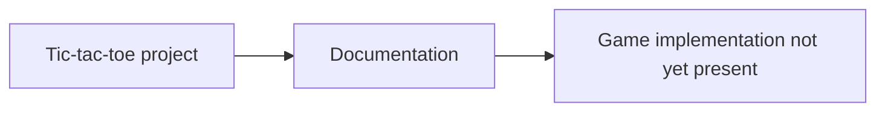

# Tic-Tac-Toe · Project Space

**English** · [简体中文](README.zh-CN.md)

Nine squares leave plenty of room for a programming question.

The repository name points to a tic-tac-toe project. At present, it contains documentation only: no game implementation, move logic, interface, or playable demo is included.

## Current state

There are no dependencies to install or commands to start a game. The diagram shows the repository's documented scope.

